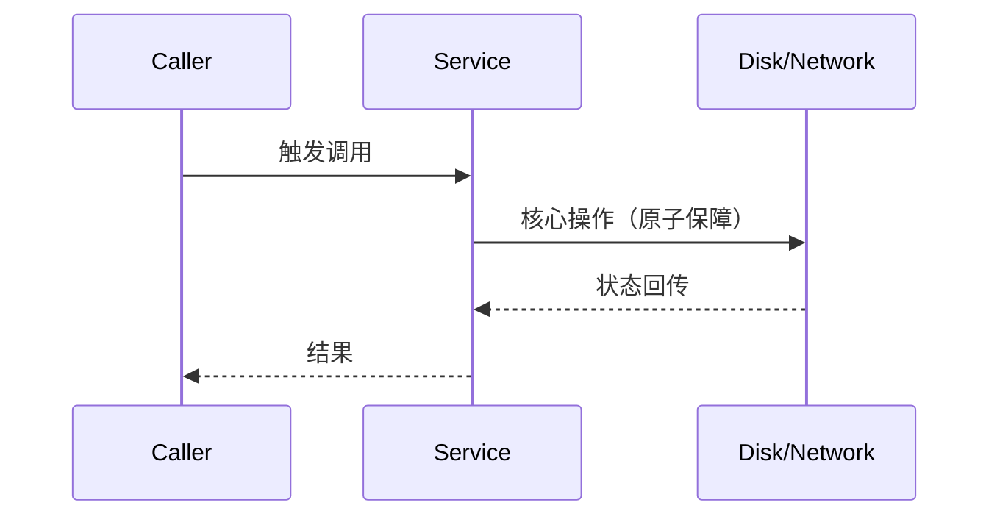
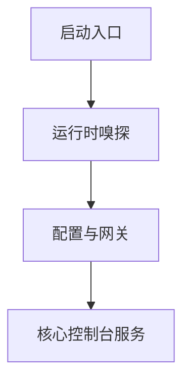

# 讲解输出模板规范 (Tech Mentor Output Templates)

---

## 模板一：提交级/功能点增量带读模板 (Commit & Diff Walkthrough)

适用于：用户刚通过 Claude / Codex / AGY 完成一个 commit 或修改了一组代码，要求带读。

```markdown
## 🎯 本次改动目标与技术背景
- **核心意图**：[一句话说明本次改动解决的核心工程问题]
- **涉及模块**：[`file_a.ext`](file:///path/to/file_a.ext), [`file_b.ext`](file:///path/to/file_b.ext)
- **底层约束/权衡**：[解释为什么采用这种改法，避免了什么代价]

---

## 🧭 架构演进与数据链路

*状态流转要点*：
1. ...
2. ...

---

## 🔬 核心代码实相 (Code Anatomy)
### 1. [模块名/关键函数] ([文件路径#行号](file:///path/to/file#L10-L30))
```language
// 摘录最关键的 10~20 行核心逻辑
function coreLogic(...) {
    // 关键细节批注
}
```
> **技术点深度解析**：
> - 这一段做了什么：
> - 为什么这样写（特定语法/底层库特性）：

---

## ⚠️ 隐蔽暗桩与防御性设计 (Gotchas & Defense)
1. **[防御点 1]**：这里写 `try { ... } catch` 针对的是什么边界？（例如平台差异、文件占用）
2. **[防御点 2]**：并发/竞态防护机制。

---

## 💡 苏格拉底互动思考 (Check for Understanding)
> **问你一个实战场景题**：
> [针对这块代码提出 1 个具启发性的问题，检验是否掌握核心机制]
```

---

## 模板二：全景架构专题逆向课模板 (Architecture Deep Dive)

适用于：针对整个大项目（如 Yi盘、Agent-Sessions），从零建立心智模型。

```markdown
# 🏛️ [专题名称] 架构全景与实现解剖

## 1. 架构定位与单一事实源 (SSOT)
- 系统在整体软件拓扑中所处的位置。
- 核心配置、状态与决策权归属于谁。

## 2. 核心挑战与方案选型
| 挑战/环境约束 | 可选方案 | 最终方案 | 权衡原因（Trade-off） |
| :--- | :--- | :--- | :--- |
| [例如 ExFAT 无法软链] | 方案 A / 方案 B | 方案 C | 为什么选 C |

## 3. 架构拓扑与交互图


## 4. 关键代码实相走读
[针对 2~3 个核心文件，抽出核心数据结构与核心方法进行显微镜级解剖]

## 5. 架构总结与复盘自测题
[提出 2 个架构推演问题]
```
